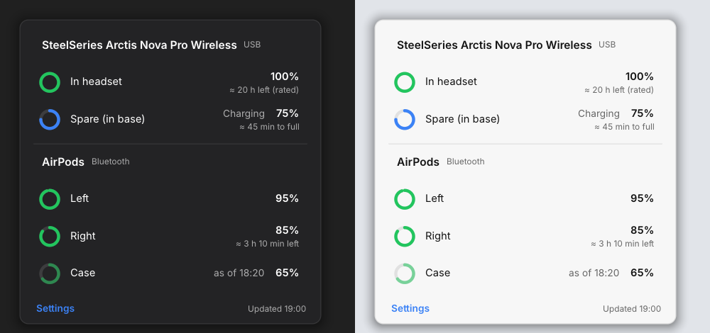

**Headroom** shows the battery of your wireless headsets right in the Windows taskbar: one small exe, no vendor software, no admin rights.

The green ring in your taskbar fills with the battery left - glance at it and you know. It turns amber and red when low, blue while charging:

Click it for the details:

### New: Claude Code usage
An optional **orange double ring** in the tray shows how much of your Claude session (outer) and weekly limit (inner) is left, with reset times in the panel, plus two matching rings under the Claude Code prompt (**Settings → Copy setup**).
**1.5.3:** Headroom shows up in Windows search (Start menu shortcut).
**1.5.2:** the inner ring stays on weekly unless Fable is ahead and getting tight.
**1.5.1:** each Claude limit has its own calm colour (violet / blue / teal) with shared warning colours.
**1.5:** Fable's weekly limit shows in the panel, hover card and (optionally) the tray's inner ring.
**1.4.7:** crashes are now captured and included in the troubleshooting report.
**1.4.6:** troubleshooting report button sits apart at the bottom right of Settings.
**1.4.5:** the troubleshooting report asks first and shortens Bluetooth addresses.
**1.4.4:** no "Estimating…" placeholder; better diagnostics for per-model Claude limits.
**1.4.3:** panel and hover card agree on "% left" / "% used"; the plan is detected automatically after an upgrade.
**1.4.2:** headset panel and Claude panel are separate; each icon opens its own.
**1.4.1:** extra weekly limits like Max's Fable limit appear in the hover card and panel.
**1.4:** Claude rings go purple → yellow → orange → red as you use them up, a redesigned hover card that appears right above the icon after 0.5 s, and a calmer green.
**1.3:** Claude look (ring = used, amber/red like Claude), a hover card like Claude's usage popup, a full red ring plus "ready in…" countdown and reminder pop-ups when the 5-hour limit runs out, and separate Headroom / Claude settings tabs.
**1.2:** works with the VS Code panel too: turn on *Settings → Read usage from my Claude login* (opt-in, unofficial endpoint). Pro/Max plans; see the [README](https://github.com/IToptimize/headroom#claude-code-usage-optional).

### Highlights
- **Tray ring** that fills with the battery left; click for a panel with every connected headset, % and estimated time left / time to full
- **USB dongles:** HyperX, SteelSeries (incl. the Arctis Nova Pro's spare battery in the base), Corsair Void, Sony INZONE, MCHOSE
- **AirPods / Beats** with separate left, right and case, plus any Bluetooth headset that reports its battery to Windows
- **Learns your real drain rate**, silent pop-ups at chosen levels, light/dark themes, accent colours, compact layout
- **Report my headset:** one click creates a text report for bug reports

### Install
1. Download **Headroom.zip** below, extract it and run `Headroom.exe`
2. Windows may say *"Windows protected your PC"* (the exe isn't code-signed): **More info → Run anyway**
3. Say **Yes** to "start with Windows" to install it (no admin needed)

Upgrading from the old **HyperX Battery** build? Just run `Headroom.exe` - settings and learned battery data move over automatically.

### Tested so far
HyperX Cloud Flight Wireless, SteelSeries Arctis Nova Pro Wireless, AirPods 4. Other supported models are untested; if you have one, try it and send a report (right-click the icon → **Report my headset…**).

See the [README](https://github.com/IToptimize/headroom#supported-devices) for the full device list.
