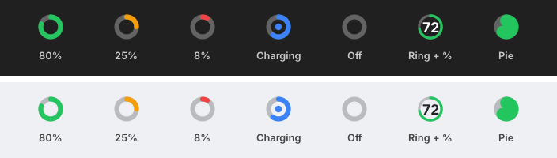

**Headroom** shows the battery of your wireless headsets right in the Windows taskbar: one small exe, no vendor software, no admin rights.

The green ring in your taskbar fills with the battery left - glance at it and you know. It turns amber and red when low, blue while charging:

Click it for the details:

### New in 1.1: Claude Code usage
An optional **orange double ring** in the tray shows how much of your Claude session (outer) and weekly limit (inner) is left, with reset times in the panel, plus two matching rings under the Claude Code prompt. Set it up from **Settings → Copy setup** (Pro/Max plans; see the [README](https://github.com/IToptimize/headroom#claude-code-usage-optional)).

### Highlights
- **Tray ring** that fills with the battery left; click for a panel with every connected headset, % and estimated time left / time to full
- **USB dongles:** HyperX, SteelSeries (incl. the Arctis Nova Pro's spare battery in the base), Corsair Void, Sony INZONE, MCHOSE
- **AirPods / Beats** with separate left, right and case, plus any Bluetooth headset that reports its battery to Windows
- **Learns your real drain rate**, silent pop-ups at chosen levels, light/dark themes, accent colours, compact layout
- **Report my headset:** one click creates a text report for bug reports

### Install
1. Download **Headroom.zip** below, extract it and run `Headroom.exe`
2. Windows may say *"Windows protected your PC"* (the exe isn't code-signed): **More info → Run anyway**
3. Say **Yes** to "start with Windows" to install it (no admin needed)

Upgrading from the old **HyperX Battery** build? Just run `Headroom.exe` - settings and learned battery data move over automatically.

### Tested so far
HyperX Cloud Flight Wireless, SteelSeries Arctis Nova Pro Wireless, AirPods 4. Other supported models are untested; if you have one, try it and send a report (right-click the icon → **Report my headset…**).

See the [README](https://github.com/IToptimize/headroom#supported-devices) for the full device list.
