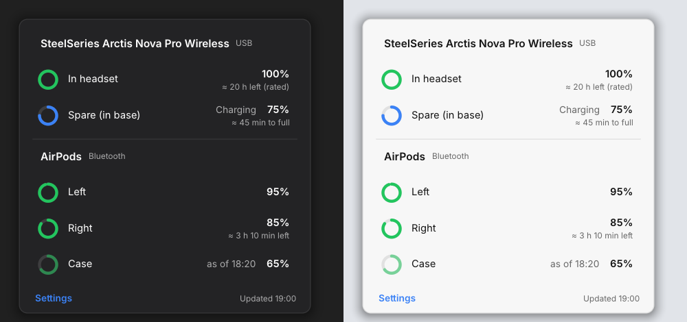
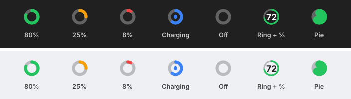
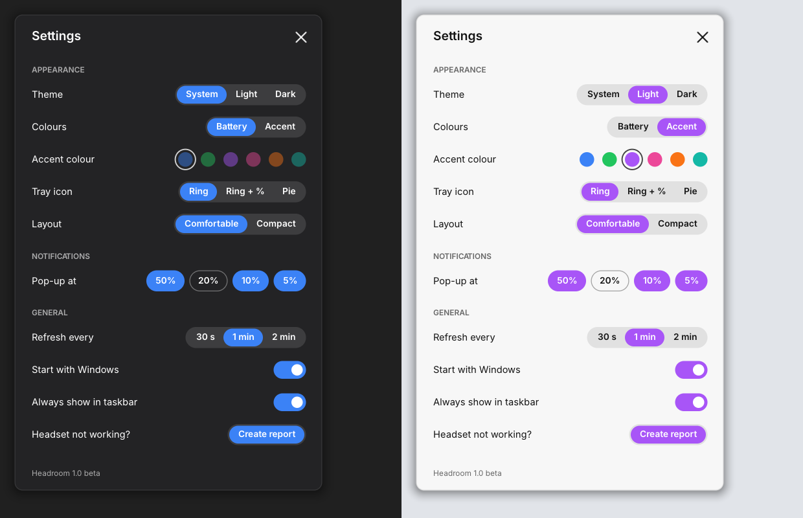

<p align="center"></p>

<h1 align="center">Headroom</h1>
<p align="center">Wireless headset battery in your Windows taskbar.<br>
One tiny exe, no vendor software, no background bloat.</p>

<p align="center"><br>
<sub>The green ring next to OneDrive is Headroom: a quick look at the taskbar tells you how much battery is left.</sub></p>

<p align="center"><br>
<sub>Click the ring for the details.</sub></p>

## What it does

<p align="center"></p>

- **Tray ring** that fills with the battery left (ring, ring + %, or pie), coloured by level, blue when charging.
- **Click** for a panel with every connected headset: %, status and an estimated time left / time to full.
- **Per-battery rows** where a device has more than one: AirPods left / right / case, SteelSeries Arctis Nova Pro headset + spare battery charging in the base.
- **Learns your real drain rate** (LEDs on/off makes a huge difference) and gets more accurate with use. Handles headsets that only report coarse steps.
- **Silent pop-ups** at 50 / 20 / 10 / 5 % (pick which).
- **Settings**: light/dark/system theme, battery colours or an accent colour, compact layout, refresh speed, start with Windows, always show in taskbar.
- **Report my headset**: one click builds a text report (devices seen, readings, recent log) for bug reports.
- **Claude Code usage** (optional): an orange ring for your Claude session and weekly limits, see below.
- ~2.8 MB single exe, a few MB of RAM, no installer and no admin rights needed.

<p align="center"></p>

## Claude Code usage (optional)

If you use Claude Code on a Pro/Max plan, Headroom can also show how much of your usage limits is left: an **orange double ring** in the tray (outer = 5-hour session, inner = week) and a *Claude* row in the panel with reset times.

It reads the numbers Claude Code hands to its status line, so it also gives you two rings under the Claude Code prompt:

```
◕ 5h 76% left · 2h 14m   ◑ week 59% left · Mon 22:21   ctx 34%
```

Setup: Headroom › Settings › **Copy setup**, then paste the block into `~/.claude/settings.json` (inside the outer `{ }`). It looks like:

```json
"statusLine": {
  "type": "command",
  "command": "C:/Users/you/AppData/Local/Programs/Headroom/Headroom.exe --statusline",
  "padding": 0
}
```

**Using the VS Code panel?** It doesn't run status lines, so Headroom can't get the numbers that way. Turn on **Settings › Read usage from my Claude login** instead: Headroom then asks Anthropic for your usage every 3 minutes (2–5, your choice) using the login Claude Code already stored on your PC (`~/.claude/.credentials.json`). This uses an **undocumented** endpoint (the same one community tools use), so it may change or break; it's off by default. The token is only read (never refreshed or changed), never logged, and only sent to `api.anthropic.com`.

Notes: with the status line, the numbers update while Claude Code is running (the tray shows "as of …" otherwise, and a window counts as full again once its reset time has passed). The status line shows in Claude Code in a terminal; the VS Code extension's side panel doesn't render custom status lines.

## Supported devices

| Brand | Models | Status |
|---|---|---|
| HyperX (USB dongle) | Cloud Flight Wireless | tested |
| | Cloud II Wireless (Kingston & HP dongles), Cloud Alpha Wireless, Cloud Alpha 2 Wireless, Cloud III Wireless, Cloud III S Wireless, Cloud II Core Wireless | untested |
| SteelSeries (USB dongle) | Arctis Nova Pro Wireless (+X), incl. spare battery | tested |
| | Arctis Nova 7 / 7X / 7P (all versions), Nova 5 / 5X, Nova 3P / 3X Wireless, Arctis 7+, Arctis 7 / Pro 2019, Arctis 1 Wireless / 7X / 7P, Arctis 9, Arctis Pro Wireless, Arctis GameBuds | untested |
| Corsair (USB dongle) | Void Wireless family (Void, RGB, Elite, Pro) | untested |
| Sony (USB dongle) | INZONE H9 II, INZONE H5 | untested |
| MCHOSE | X9 | untested |
| Apple / Beats | AirPods (all), Beats: left, right and case from their Bluetooth broadcast | tested (AirPods 4) |
| Any Bluetooth headset | anything that shows its battery in *Settings › Bluetooth & devices* | tested |

"Untested" means the protocol is ported from an open-source project but nobody has confirmed it on real hardware with Headroom yet. If you own one, please try it and report back (right-click › **Report my headset…**).

## Install

1. Download `Headroom.zip` from [Releases](../../releases), extract it, run `Headroom.exe`.
2. The exe isn't code-signed, so Windows may show *"Windows protected your PC"*: **More info › Run anyway**.
3. Answer *Yes* to "start with Windows" to install it to `%LOCALAPPDATA%\Programs\Headroom` (no admin). Running a newer `Headroom.exe` later updates the installed copy.

Upgrading from the old **HyperX Battery** build: just run `Headroom.exe`; it moves your settings and learned battery data over and removes the old version.

Uninstall: right-click › untick *Start with Windows* › Exit, then delete `%LOCALAPPDATA%\Programs\Headroom` (settings live in `HKCU\Software\Headroom`).

## Build from source

Pure Go, no cgo; dependencies are vendored, so no network is needed:

```sh
GOOS=windows GOARCH=amd64 go build -trimpath -ldflags "-s -w -H windowsgui" -o Headroom.exe .
```

The icon, manifest and version info come from `rsrc_windows_amd64.syso`, generated from `assets/headroom.rc`:

```sh
llvm-windres --target=pe-x86-64 -i assets/headroom.rc -o rsrc_windows_amd64.syso
```

Every push to `main` is built and vetted. To publish a release, bump `VERSION`: the workflow creates the `v…` tag and a GitHub release with `Headroom.exe` and `Headroom.zip` (see `.github/workflows/build.yml`).

### How it reads batteries

- **USB dongles**: talks HID directly (`hid.go`, `protocols.go`, `brands.go`), probing the right interface per model.
- **Bluetooth**: reads the battery level Windows already stores for the device (`bt.go`).
- **AirPods / Beats**: listens for Apple's proximity-pairing BLE broadcast while AirPods are connected (`airpods.go`).
- **Estimates**: `estimate.go` (median smoothing for voltage-based headsets, step timing for coarse ones, learned rates per device).

## Credits

- HyperX, SteelSeries, Corsair, Sony and MCHOSE protocol details from [HeadsetControl](https://github.com/Sapd/HeadsetControl) (GPL-3.0) and [HyperHeadset](https://github.com/LennardKittner/HyperHeadset) (MIT).
- AirPods broadcast format as documented by OpenPods / AirPodsDesktop.
- [winrt-go](https://github.com/saltosystems/winrt-go) (MIT), [go-ole](https://github.com/go-ole/go-ole) (MIT), [golang.org/x/sys](https://pkg.go.dev/golang.org/x/sys) (BSD-3-Clause).

Headroom is not affiliated with HyperX, HP, SteelSeries, Corsair, Sony, Apple or MCHOSE. Product names are trademarks of their owners.

## License

GPL-3.0, see [LICENSE](LICENSE).
